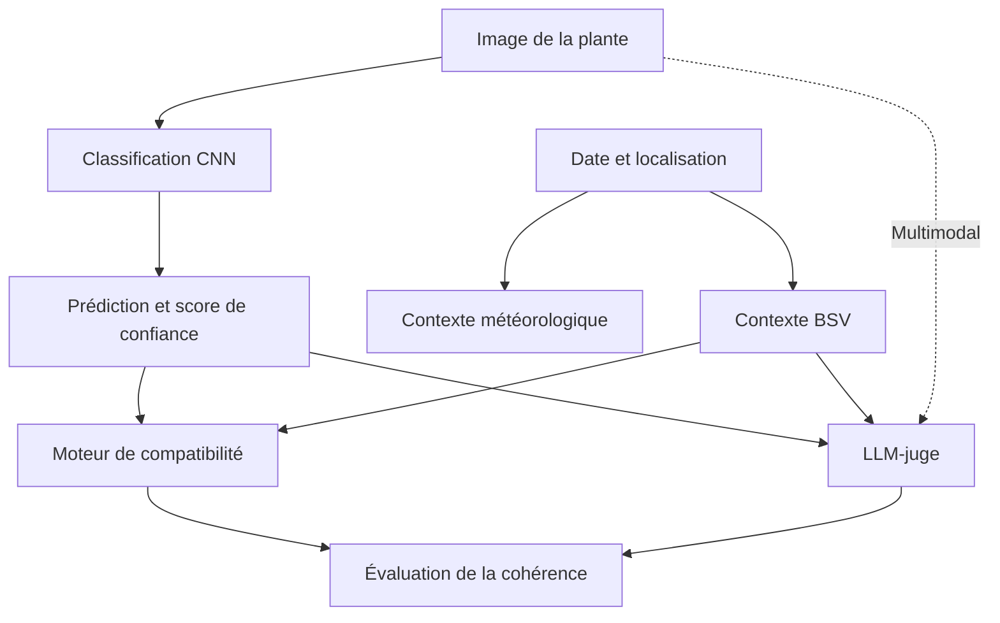

# Stage DJMA × ImHorPhen — Diagnostic contextualisé des pathologies végétales par IA

## Présentation du projet

Ce dépôt rassemble les travaux réalisés dans le cadre de mon stage de Master 2 Data Science à l'Université d'Angers, en partenariat avec :

- **ImHorPhen (Imagerie pour l’Horticulture et le Phénotypage)** : équipe de recherche spécialisée dans l'imagerie, le traitement des données et l'intelligence artificielle appliqués au phénotypage végétal, en lien avec le LARIS et l'Institut de recherche en horticulture et semences (IRHS).
- **Dr. Jonquille & Mr. Ail (DJMA)** : entreprise développant une application mobile d'accompagnement et de conseil pour les jardiniers.

L'objectif du stage est de développer et d'évaluer un pipeline de diagnostic contextualisé des pathologies végétales, en combinant l'analyse d'images, les données environnementales et les informations phytosanitaires.

La tomate constitue la culture pilote de cette étude.

## Architecture générale

Le projet s'articule autour de trois phases complémentaires :

1. **Diagnostic visuel** : classification et segmentation d'images.
2. **Contexte météorologique** : reconstruction des conditions environnementales.
3. **Corroboration phytosanitaire** : moteur de règles et LLM-as-a-Judge.



Le contexte météorologique constitue une branche exploratoire dont la faisabilité technique a été étudiée séparément.

## Phase 1 — Vision par ordinateur

### Constitution du jeu de données

- Collecte et fusion de trois jeux de données publics.
- Harmonisation des classes.
- Détection des images corrompues et suppression des doublons par empreinte MD5.
- Constitution d'un corpus nettoyé de 22 349 images réparties en 12 classes.
- Découpage stratifié des données et rééquilibrage du jeu d'entraînement.

### Classification des pathologies de la tomate

Développement d'un modèle de classification ResNet-50 par transfert d'apprentissage et fine-tuning.

L'évaluation est réalisée sur un jeu de test figé de 3 761 images, selon un protocole expérimental utilisant huit graines aléatoires.

### Segmentation et étude d'ablation

Évaluation de l'intérêt de la segmentation préalable des feuilles avec SAM 3 (Segment Anything Model 3).

Trois approches sont comparées :

- Classification sur image complète.
- Classification avec atténuation de l'arrière-plan.
- Segmentation SAM 3 suivie d'une classification ResNet-50.

Les résultats conduisent à retenir la classification sur image complète comme baseline pour la suite du projet.

## Phase 2 — Reconstruction du contexte météorologique

Développement d'un pipeline de récupération et de traitement des données météorologiques historiques à partir de l'API Open-Meteo.

Les principales étapes sont :

- Vérification de la disponibilité des métadonnées des observations.
- Récupération des séries météorologiques à partir de la date et de la localisation.
- Construction d'une fenêtre historique de 20 jours précédant l'observation.
- Calcul d'indicateurs environnementaux et agronomiques.

Cette phase valide la faisabilité technique du pipeline, tout en mettant en évidence les limites liées à la disponibilité des métadonnées et à la représentativité locale des données météorologiques.

## Phase 3 — Corroboration phytosanitaire

### Constitution du corpus BSV

Collecte et structuration de 229 Bulletins de Santé du Végétal (BSV), couvrant la période 2023–2025 pour trois régions françaises :

- Pays de la Loire.
- Grand Est.
- Provence-Alpes-Côte d'Azur.

Un référentiel de correspondance entre les classes du CNN et les informations phytosanitaires des bulletins est construit afin de permettre leur exploitation automatisée.

### Moteur de compatibilité contextuelle

Développement d'un moteur de règles permettant d'évaluer la cohérence entre la prédiction du CNN et le contexte phytosanitaire disponible.

Le moteur prend notamment en compte :

- La classe prédite.
- La date de l'observation.
- La région.
- La disponibilité et le contenu des bulletins.
- Les fenêtres saisonnières de pertinence.

Les verdicts sont regroupés en trois catégories principales :

- **Cohérent** : contexte compatible avec la prédiction.
- **Non corroboré** : contexte ne corroborant pas la prédiction selon les règles établies.
- **Indéterminé** : informations insuffisantes pour conclure.

Une analyse statistique évalue l'apport du verdict BSV en complément du score de confiance du CNN, à l'aide de régressions logistiques, d'une validation croisée groupée et d'un bootstrap groupé.

### LLM-as-a-Judge

Développement d'un pipeline d'évaluation de la plausibilité contextuelle des prédictions du CNN à l'aide de modèles de langage multimodaux.

Après des expérimentations exploratoires avec Qwen2.5-VL-7B, le modèle Qwen2.5-VL-32B est retenu pour l'évaluation finale.

Deux configurations sont étudiées :

- **Contextuelle** : prédiction du CNN et informations BSV.
- **Multimodale** : prédiction du CNN, informations BSV et image de la plante.

Le dispositif comprend :

- Prompt engineering.
- Validation des réponses par schéma JSON.
- Contrôle automatique de la conformité au protocole.
- Analyse comparative des verdicts.
- Évaluation de l'apport de la modalité visuelle.

## Principaux résultats

| Composante | Résultats |
|---|---|
| Classification ResNet-50 | Accuracy : 90,35 % ± 0,59 % |
| Classification ResNet-50 | Macro-F1 : 88,82 % ± 0,70 % |
| Segmentation SAM 3 | Pas d'amélioration par rapport à la baseline |
| Contexte météorologique | 33 observations réelles exploitables |
| Couverture BSV | 9 classes sur 12 |
| Moteur de compatibilité | 1 246 observations avec verdict exploitable |
| Apport du BSV | Signal statistique complémentaire au score CNN |
| LLM-juge | 7 522 réponses exploitables |
| Conformité automatique du LLM contextuel | 96,28 % |
| Conformité automatique du LLM multimodal | 93,43 % |

Les résultats mettent en évidence l'intérêt d'une contextualisation des prédictions visuelles, tout en soulignant les limites de la couverture des données et de l'utilisation des LLM comme outils de corroboration.

Le pipeline constitue un prototype expérimental et ne remplace pas une expertise phytosanitaire.

## Travaux préliminaires — Validation sémantique par NLI

Le stage s'inscrit dans la continuité d'un projet annuel de Master 2 consacré à l'Inférence en Langage Naturel (NLI).

Ce travail explorait la validation sémantique de descriptions de pathologies végétales générées par des modèles d'intelligence artificielle, en les comparant à des descriptions expertes.

L'approche NLI n'est pas directement intégrée au pipeline final du stage, mais constitue le point de départ de la réflexion sur la validation des diagnostics produits par l'IA.

## Structure du dépôt

```text
Djma_Imorphen_stage/
├── src/              # Code source des pipelines
├── notebooks/        # Exploration, expérimentations et analyses
├── scripts/          # Scripts d'exécution et d'entraînement
├── tests/            # Tests unitaires
├── docs/             # Documentation technique
├── data/             # Données brutes et transformées
├── outputs/          # Prédictions, métriques et résultats
├── requirements.txt  # Dépendances Python
└── README.md
```

## Technologies utilisées

| Domaine | Technologies et outils |
|---|---|
| Langage | Python |
| Machine Learning | scikit-learn |
| Deep Learning | PyTorch, ResNet-50 |
| Computer Vision | SAM 3, OpenCV, Pillow |
| LLM et VLM | Qwen2.5-VL, Ollama |
| Traitement des données | pandas, NumPy |
| Données météorologiques | Open-Meteo |
| Analyse statistique | SciPy, statsmodels |
| Visualisation | Matplotlib, Seaborn |
| Suivi des expérimentations | MLflow |
| Calcul haute performance | Slurm, GPU, GLiCID |
| Gestion de versions | Git |

## Installation

```bash
# Créer un environnement virtuel
python -m venv .venv

# Activer l'environnement
source .venv/bin/activate

# Installer les dépendances
pip install --upgrade pip setuptools wheel
pip install -r requirements.txt
```

Certaines expérimentations nécessitent des ressources GPU, ainsi que des données et des poids de modèles spécifiques.

## Utilisation

- [Notebooks de classification](notebooks/classification_tomato/)
- [Notebooks NLI](notebooks/nli/)
- [Scripts d'exécution](scripts/)
- [Notebooks d'analyse du moteur BSV](notebooks/moteur/)
- [Documentation du moteur de compatibilité](docs/moteur/phase3_moteur.md)

Pour simuler les étapes du pipeline BSV sans lancer les traitements :

```bash
python src/moteur/run_pipeline.py --dry-run
```

## Limites et perspectives

- Évaluation sur davantage d'observations collectées en conditions réelles.
- Amélioration de la disponibilité et de la qualité des métadonnées.
- Extension de la couverture phytosanitaire à d'autres cultures.
- Validation des verdicts par des experts.
- Évaluation de la robustesse et de la reproductibilité du LLM-juge.

## Auteur

**Coletta Moutsiha**

Master 2 Data Science — Université d'Angers

Stage de recherche et développement en intelligence artificielle — Mars à septembre 2026.

## Partenaires

- Dr. Jonquille & Mr. Ail (DJMA)
- Équipe ImHorPhen, Institut de recherche en horticulture et semences (IRHS)
- Université d'Angers
